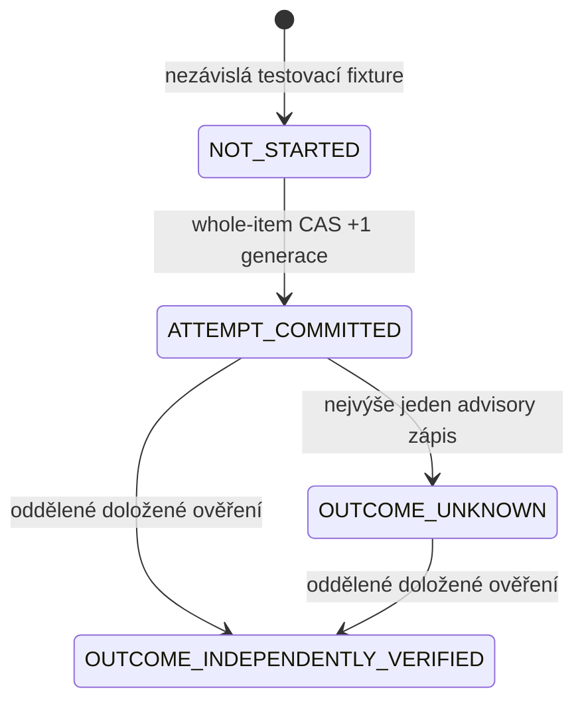

# Trvale spotřebovaný pokus: offline zotavení po timeoutu a restartu

Základ: `d91e44eb6a2fefed7f7e336fe5020791ddec32e0` (PR #39).
Nový čistý detached worktree: `/workspace/vrchcab-recovery-d91e44e`.
Datum: 2026-11-09. Staré pracovní kopie a produkční soubory se nemění.

Tento návrhový audit vznikl před implementací. Nahrazuje požadavek důkazu
jediného odeslaného DB pokusu přesnějším bezpečnostním kontraktem. Starý
dokument a jeho negativní testy zůstávají historicky i obsahově beze změny.

## Kontrakt a počty

Rozlišujeme DB requesty, úspěšné atomické commity, jednoznačně potvrzené
commity, vydaná jednorázová pokračování, povolené vstupy do externího
transportu, fyzické HTTP pokusy a skutečné účinky/účtování poskytovatele.
Například 2 DB requesty mohou znamenat 1 commit, 0 potvrzení a 0 externích
požadavků. Ani HTTP 200 není univerzální důkaz provedeného účinku.

Bezstopý timeout před commitem může při další explicitní invokaci vést
k novému DB pokusu. To samo neporušuje kontrakt. Podmínka stejné generace
a celého itemu dovolí nejvýše jeden přechod prázdného owner slotu a nejvýše
jeden přechod NOT_STARTED → ATTEMPT_COMMITTED pro pevně určenou operaci.
Uvnitř handleru se žádný nejasný zápis automaticky neopakuje.

**Modelový invariant:** pokud všichni writeři používají tento protokol,
neobnovuje se stará autorita, ingress/identity/clock jsou důvěryhodné a
externí transport vykoná nejvýše jeden request při jednom volání, může
jednoznačně potvrzený gate commit vytvořit nejvýše jedno pokračování
k jednomu externímu odeslání. Žádný readback sám pokračování nevytvoří.
Restart nebo nová invokace jej z uloženého záznamu nikdy neobnoví.

To je **at-most-once admission**, nikoliv exactly-once effect. Pád před
odesláním může nevratně spotřebovat pokus, aniž by nastal účinek. Pád po
odeslání nechává stejný slot spotřebovaný a výsledek nejasný.

## Co současný projekt řeší a co nezaručuje

| Hranice | Současné chování / možná nejistota | Vztah nového modelu |
| --- | --- | --- |
| Rezervace V2 | reserve_with_store zapisuje intent a kumulativní denní rezervaci; nejistý ACK není dispatch. Opakování, nová epocha nebo nechráněný writer mohou být problém | V2 beze změny; žádná nová rezervace při claimu nebo pokusu |
| V3 claim / DynamoDB | Jedna condition s generací, owner slotem, celým dokumentem a run bindingem. SDK může poslat více HTTP pokusů; ztracený ACK neudělí oprávnění | Stávající gateway/engine se znovu použijí nad projekcí téhož celého itemu |
| Perplexity Agent | PerplexityAutoRunBudget je procesní guard; drží attempt před POST, při nejistotě blokuje. Nepřežije restart jako autoritativní denní ledger a negarantuje cenu jediného requestu | Nový slot je durable, ale jen pro falešného poskytovatele; nepřipojuje se do research_safety nebo runtime |
| Ostatní placené modely | retry_research a allowed_tries mohou opakovat transientní chyby; Agent bez guardu má AGENT_ATTEMPTS=3. Model invoke/SDK/retry dekorátor není automaticky single-send | Žádná obecná záruka pro dnešní modely; budoucí každý konkrétní request potřebuje pevný slot a ověřené vypnutí všech retry |
| GitHub dispatch | Autonomní controller nic živě nedispatchuje. Budoucí POST může vytvořit run, i když ACK nedorazí; ruční rerun a nový run nejsou potvrzení předchozího výsledku | Samostatný slot před skutečným dispatch; zde jen syntetický druh operace, žádný dispatch API |
| Metaculus forecast/comment | Publisher má saved plan, sending/uncertain a explicitní single-attempt POST; rejected může v pozdějším běhu projít znovu a manuální reconcile umí ready | Produkční žurnál se nemění. Nový přísnější model nerecykluje slot ani po 429 nebo prokázané absenci. Nemá být přidán jako druhý ledger vedle žurnálu |
| Výsledek/settlement | assess_settlement je pouze návrhové multi-source evidence, nikdy automatické vyčištění. GitHub conclusion ani lokální response cost nejsou billing proof | Nejasnost zůstává; jediné implementované potvrzení výsledku bude od oddělené syntetické autority, bez release/refundu |

Budoucí skutečná autorita musí sloučit rezervaci, kvótu, run binding, owner
a pokusy do jednoho atomického dokumentu. Tento patch produkční žurnál,
scheduler, publisher a jejich kontrakty nepřepisuje a netvrdí globální
ochranu již existujících živých cest.

## Minimální izolovaný formát a stavový automat

Záměrně se modeluje **jediná předem určená syntetická externí operace na
rezervovaný intent**. Nejde o implementaci celého výzkumného pipeline.
Další operace, libovolné přidání slotu nebo změna requestu jsou DENY.
Budoucí katalog více operací musí být předem pevný, ve stejném itemu,
s neměnnými sémantickými klíči a zachovanými spotřebovanými záznamy.

Nová offline obálka obsahuje nezměněný command draft V3 a navíc protokol
a jeden effect record. V něm jsou intent/epoch/authorization ID/run ID,
konfigurace, provider/kind/sémantický klíč/request, konkrétní request cap
a intent reserve. Operation ID a attempt ID odvozuje server. Gate record
obsahuje generaci commitu, čas a vazbu na vlastníka. Částky jsou přesné
desetinné stringy, nikoliv float. Vše leží v jediném SQLite control řádku
modelujícím jeden DynamoDB item. Není druhý control ledger ani durable
cache oprávnění. Statistiky a historie falešného poskytovatele jsou jen
testovací pozorování účinků, ne zdroj povolení odeslat.

Z ATTEMPT_COMMITTED se neodvozuje, že byl request skutečně odeslán. Je to
durable zákaz nového pokračování. Nejasný gate ACK nevytvoří pokračování
ani po pozdějším GET. Pád původní obsluhy pokračování zničí. Krátké lokální
jednorázové pokračování hlídá pouze opakované použití v téže obsluze;
autorizační slot a ochranu přes restart vždy určuje atomicky uložený stav.
Pokračování se nevrací workeru, neserializuje se a nemá API pro obnovu.

Výsledek poskytovatele (i 200) je jen pozorování; případný navazující zápis
OUTCOME_UNKNOWN může také selhat. Už samotné ATTEMPT_COMMITTED bezpečně
blokuje nové odeslání. Pouze oddělená testovací autorita může potvrdit účinek
a známé účtování. Chybějící request v historii, neúplné billing nebo běžící
originál nejsou důkaz NO_EFFECT. Slot se v tomto modelu nikdy nevrací do
NOT_STARTED, neuvolňuje, neexpiruje a neznovuotevírá ani po rekonciliaci.

## Failure modes před implementací

| Událost | Bezpečný výsledek |
| --- | --- |
| Timeout před commitem | Žádné pokračování/externí volání; další explicitní invokace může zkusit CAS na stále NOT_STARTED. Je to další DB request, nikoliv druhý úspěšný gate |
| Commit a ztracený/nejednoznačný ACK | Durable spotřebovaný slot, žádné externí volání z nejasné obsluhy; readback nesmí znovu vydat oprávnění |
| Pád po potvrzení a před voláním | Slot zůstává spotřebovaný, nula účinků je přípustná ztráta dostupnosti |
| Pád po účinku před uložením výsledku | Slot zůstává spotřebovaný, výsledek UNKNOWN, žádné znovuodeslání |
| Zpožděná původní odpověď | Již ukončená obsluha ji ignoruje. Ještě běžící původní obsluha může po platném potvrzení nejvýše jednou pokračovat; nová invokace nesmí získat druhé pokračování |
| Dva workeři / rerun | Owner CAS i gate CAS dovolí nejvýše jeden commit; jiný run/attempt identity se odmítne |
| Síťová chyba, 500, 429 | Konzervativní UNKNOWN a spotřebovaný slot; žádný automatický provider retry, ani pro HTTP rejection |
| OFF před gate/final check | Žádné nové povolené odeslání; rezervace a owner zůstávají |
| OFF po posledním checku / během requestu | Může doběhnout nejvýše jeden již povolený request. DB a externí služba nejsou jedna transakce; okamžité storno či odvolání drženého pokračování se negarantuje |
| Nejasný billing/publikování | UNKNOWN a nezávislá rekonciliace; nikdy automatický refund nebo další POST |
| Privilegovaný rollback | Starý slot pod stejným bindingem může znovu otevřít oprávnění. Musí zůstat negativní protipříklad; nový chráněný incarnation/cíl a nezávislá rekonciliace jsou podmínkou restore |
| Skryté retry uvnitř poskytovatele | Jedno povolení transportu nemusí znamenat jeden HTTP request. Chybný transport zůstává negativní protipříklad a produkční blocker |

## Auditní závěr před kódem

Úzký návrh pro syntetickou autoritu a explicitní single-send falešný
transport prochází. Bezpečnost upřednostňuje trvalé zablokování nejasného
pokusu před jeho zopakováním. Nevyžaduje nemožnou trvalou historii každého
bezstopého DB requestu ani spoléhání na časově omezenou idempotenci AWS.
Privilegovaný restore, transport se skrytými retry a OFF po poslední
kontrole nejsou vyřešené distribuovanou transakcí. Produkční cesta zůstává
**PRODUCTION DENY**.

## Podmínky potvrzení a důkaz v modelu

Každý kladný ACK musí patřit **této konkrétní podmíněné UpdateItem operaci**.
Není přípustné převést starý úspěch idempotentní transakce nebo GET stejného
obsahu na nové povolení odeslat. Transport je součástí TCB; HTTP metadata,
ResponseMetadata.RetryAttempts nebo Python typ samy neprokazují jeho poctivost.

1. Owner slot může přejít pouze null → jeden owner, s podmínkou celého
   původního stavu, epochy/run authorization/nového effect recordu a generace.
   Revize zahrnuje physical binding/incarnation i monotónní generaci.
2. Pokus lze zapsat jen pro již potvrzeného vlastníka, stejné schválené
   run ID/attempt=1, tentýž intent/epochu a pevnou operaci. Zápis zachová
   owner, finanční rezervaci, počty pokusů rezervace a veškerý zbytek control
   dokumentu. Condition porovná všech osm atributů obálky, +1 je konstanta.
3. První commit změní generaci a NOT_STARTED nevratně opustí. Při poctivém
   conditional UpdateItem další kandidát nemůže dostat kladné potvrzení
   téhož přechodu. Starý/stale GET se rozbije o aktuální DB condition.
4. Teprve přesný ALL_NEW ACK bez hlášených retry a strong readback shodný
   s celým návrhem vytvoří jedno lokální pokračování. Následuje kontrola
   identity a aktuálního úplného stavu před vstupem do poskytovatele.
5. Pokračování lze spotřebovat jednou, nikdy se nevrací přes veřejné API.
   Copy/deepcopy/serializace se odmítají. Důvěryhodný runtime nesmí fork/checkpoint
   živého pokračování klonovat do více procesů. Lokální lock řeší jen totéž
   pokračování; persistentní CAS řeší ostatní invokace a restarty.
6. V žádné fázi není přechod zpět, změna requestu/operation ID, lease,
   převzetí jiným vlastníkem, auto reset, refund, nové schválení runu či
   obnovení oprávnění podle clocku. Read ani výsledek rekonciliace nikdy
   nevytvoří pokračování.

Minimalita je záměrná: 1 pevná operace na intent. Čtyři druhy operací v testech
jsou čtyři nezávislé syntetické scénáře s čerstvou autoritou, nikoliv povolení
čtyř requestů v jednom živém runu. Skutečný plán **2 reporty × 3 prognózy**
potřebuje **4 Agent POST** proti automatickému limitu **2** a zůstává blokován.
Model tento rozpor neřeší změnou plánu, rozpočtu ani snížením počtu reportů.
Budget cap v recordu je deklarovaný schválený limit, nikoliv důkaz hard spend
cap poskytovatele. Jediný request může skutečnou cenu překročit; takový stav
se v testu odmítne potvrdit a rezervace se nesníží.

Příklad skutečně asertovaných počtů v nových testech, **po již potvrzeném
claimu**. DB requesty/commity zahrnují i případný advisory OUTCOME_UNKNOWN:

| Scénář | DB requesty | DB commity | Kladný gate ACK uvnitř obsluhy | Povolené vstupy do transportu | Fyzické falešné requesty | Falešné účinky |
| --- | ---: | ---: | ---: | ---: | ---: | ---: |
| Normální jedna operace + advisory zápis | 2 | 2 | 1 | 1 | 1 | 1 |
| Timeout před commitem | 1 | 0 | 0 | 0 | 0 | 0 |
| Tentýž timeout + pozdější explicitní úspěšná invokace | 3 | 2 | 1 | 1 | 1 | 1 |
| Gate commit + ztracený ACK | 1 | 1 | 0 | 0 | 0 | 0 |
| Pád po potvrzení před voláním | 1 | 1 | 1 | 0 | 0 | 0 |
| Pád po volání před outcome zápisem | 1 | 1 | 1 | 1 | 1 | 1 |
| Chybný provider transport s vnitřním retry | 2 | 2 | 1 | 1 | 2 | 2 |

Kladný interní gate ACK nemusí být výsledek doručený worker klientovi: server
může po potvrzení spadnout. Poslední řádek je **negativní protipříklad mimo
single-send předpoklad**, nikoliv tvrzení o bezpečném retry. Testy sledují
počty zvlášť a neslučují committed slot, provider response a skutečný účinek.

## AWS a GitHub: oficiální dokumentace versus model

Byly čteny veřejné oficiální zdroje v neměnných revizích; neproběhl požadavek
na DynamoDB, Lambda, STS, GitHub REST/GraphQL ani jiný produkční API endpoint.
Přesné URL/SHA-256 a přesunutý odkaz s 404 jsou v externím reference-manifest.json.
documentation-excerpts.json zachovává relevantní normativní texty.

### DynamoDB UpdateItem a TransactWriteItems

Oficiální [DynamoDB API model](https://github.com/boto/botocore/blob/135910e22c937b9ff03b0948a633a2913d62af87/botocore/data/dynamodb/2012-08-10/service-2.json)
popisuje strong GetItem přes ConsistentRead=true, ConditionExpression jako
nutnou podmínku úspěchu UpdateItem a možnost vrátit ALL_NEW. UpdateItem může
jinak provést upsert; proto musí být kontrola existence součástí condition.
Tento model používá jednu položku, žádné globální tabulky, GSI, TTL nebo cache.
Počáteční V3/command engine a codec se nemění. Obálka recovery má izolovaný
limit 16 KiB, zatímco projekce základního command draftu stále 4 KiB; nejde
o limity služby ani produkční storage formát. Generační headroom zachovává
poslední inkrement pro OFF; při vyčerpání se nepovolí další pokus.

`TransactWriteItems.ClientRequestToken` má podle téhož oficiálního modelu
idempotenci **10 minut po dokončení prvního requestu**. Později stejný token
znamená nový request. Jiné parametry v tomto okně vedou k IdempotentParameterMismatch.
Více identických požadavků může mít stejný výsledek na serveru; odpovědi
nemusejí být stejné (například účtování read/write capacity).

Z toho **neplyne** trvalá historie pokusů, zákaz přenosového retry, ochrana
externího POST nebo jediný vydaný grant. I v desetiminutovém okně může více
obsluh dostat kladnou odpověď téhož idempotentního commitu. Pokud každá
vytvoří pokračování, mohou nastat dva účinky. Nový deterministický negativní
test to ukazuje transportem přehrávajícím kladný výsledek: **1 gate commit,
2 kladná potvrzení, 2 pokračování a 2 falešné účinky**. Je to syntetický
protipříklad naivního překladu takové odpovědi, nikoliv volání TransactWriteItems
nebo tvrzení o chybě DynamoDB.

Proto se idempotentní success cache nepoužívá jako vydavatel oprávnění.
Pro jediný item postačí přímý conditional UpdateItem s permanentním stavem.
Případná budoucí transakční implementace musí znovu prokázat, kdo smí vytvořit
pokračování; readback a ClientRequestToken samotné toto nerozliší. Aktuální
prototyp TransactWriteItems neimplementuje ani nepřijímá ClientRequestToken.

### SDK retry

[Boto3 retry průvodce](https://github.com/boto/boto3/blob/ed37b7307d34ec755afb45f9db9a7b5eb6c1bb4d/docs/source/guide/retries.rst)
a [botocore Config](https://github.com/boto/botocore/blob/135910e22c937b9ff03b0948a633a2913d62af87/botocore/config.py)
rozlišují `total_max_attempts=1` včetně počátečního pokusu a `max_attempts`
uvnitř Config jako počet retries. Explicitní standard mode a total_max_attempts=1
se musí ověřit v každé vrstvě. Nelze spoléhat na default, prostředí nebo
jednu Python funkci bez znalosti vnitřního klienta.

Stávající skutečný botocore lab se znovu spustil se syntetickým HTTP/pool:
legacy 500 → 10 pokusů, standard default → 3, explicitní limit → 1;
po commitu a ztraceném ACK default může poslat další podmíněný request a
vrátit konflikt, přestože první commit proběhl. Nový model takový SDK-like
průběh rovněž testuje: 2 DB requesty, 1 gate commit, 0 pokračování, 0 účinků.
Více DB pokusů zde není zaměněno za více commitů nebo povolených POST.
Real SDK lab není test nové recovery obálky na skutečné AWS službě.

### Lambda synchronně a asynchronně

Oficiální [Lambda API model](https://github.com/boto/botocore/blob/135910e22c937b9ff03b0948a633a2913d62af87/botocore/data/lambda/2015-03-31/service-2.json)
pro Invoke uvádí:

- RequestResponse je synchronní default; HTTP 200 neznamená, že funkce
  dokončila obchodní operaci bez chyby. Function errors jsou v body/headers.
  Klient může odpojit spojení při čekání na dlouhou funkci; timeout klienta
  není potvrzení zastavení původní obsluhy.
- Event je asynchronní fronta; HTTP 202 potvrzuje přijetí požadavku,
  nikoliv provedený claim nebo účinek. Při chybě funkce ji Lambda může
  vykonat až dvakrát znovu. Dokumentace výslovně připouští stejné eventy
  několikrát **i bez chyby**; event může být také nedoručen/ztracen.
- Retry závisí na klientovi, event source, typu chyby a typu invokace.
  MaximumRetryAttempts a MaximumEventAgeInSeconds jsou konfigurace async
  doručování, nikoliv permanentní deduplikace nebo účetní historie.
  Ani nastavení retry na nulu není důkazem jediného doručení ze všech vrstev.
- DryRun HTTP 204 jen validuje parametry/oprávnění, není důkazem bezpečnosti
  celé autority nebo výkonem skutečné operace.

Budoucí sync ingress je jednodušší kandidát, ale není aktivován. Event,
SQS/queue mapping, retry klienta, destination/DLQ redrive a kopie živého
runtime kontextu nesmějí obejít stejný durable slot. Není zde Lambda,
API gateway, queue nebo nastavení jejich permissions/retry. Potvrzení
workera musí odlišovat čekající originál a již ukončenou obsluhu; nová
invokace nemá automatický fallback k provideru.

### GitHub Actions a identita

Oficiální [re-run dokumentace](https://github.com/github/docs/blob/8cd1075179df75319912891d6620c9cb78eefb4d/content/actions/how-tos/manage-workflow-runs/re-run-workflows-and-jobs.md)
uvádí stejné GITHUB_SHA/GITHUB_REF a původní actor privileges při rerunu;
část jobs může převzít dřívější outputs. Shoda lokálního SHA, úspěšný job
nebo nový run nejsou důkazem původního účinku ani nové finanční rezervace.
[OIDC reference](https://github.com/github/docs/blob/8cd1075179df75319912891d6620c9cb78eefb4d/content/actions/reference/security/oidc.md)
rozlišuje run ID a run attempt. Zůstává přesné schválené run ID, attempt=1,
repo/owner ID a source/workflow SHA ověřené proti serverové policy a trusted
klíčům. Žádné lokální env nebo caller verified flag není důkazem.

Serverový configuration_digest je deklarace schválené konfigurace v témže
itemu, ne atestace vykonaného kódu, závislostí nebo promptů. Produkční klíče,
OIDC/STS/SigV4 vazba invoke role na run, actual token compatibility a runtime
artifact binding nejsou vyřešeny. Staré fail-closed podmínky včetně známé
striktnosti JWT headeru se neoslabují. Worker má v budoucím návrhu jen invoke;
kontrola raw DB writera, deploymentu, restore a admin bypassů stále vyžaduje
oddělenou chráněnou control plane a skutečné přezkoumání IAM. Nic takového
se v tomto úkolu nevytváří.

## Nezávislá rekonciliace a zbývající rizika

Nejasný gate ACK, pád před/po provideru, timeout/reset, neúplná odpověď,
500/429, výpadek outcome zápisu, zpožděný originál, nejisté OFF, chybějící
billing či historie publikování vyžadují nezávislé šetření. Prázdná historie
není NO_EFFECT. Před závěrem o absenci je nutné prokázat ukončení původních
obsluh a in-flight requestů i finálnost všech potřebných externích zdrojů.
Takový no-effect recovery příkaz se zde neimplementuje. Slot zůstává spotřebovaný
i tehdy, když externí test ve skutečnosti nic neposlal.

Implementované pozitivní ověření je explicitně jen syntetické: samostatně
registrovaná interní autorita spojí unikátní falešný receipt, operation/attempt/
request digest a známé účtování. Worker ani STOP principal ji nemohou nahradit
flagy nebo poslaným evidence objektem. Neúplný, cizí, budoucí nebo nadlimitní
důkaz zůstane UNKNOWN. Potvrzení jedné operace není settlement celého runu,
vyčištění pending, refund ani oprávnění spustit další práci.

OFF atomicky zabrání novému gate a kontrola před providerem odmítne již
pozorované OFF. **Mezi posledním GET a cizí službou není atomická hranice.**
OFF po této kontrole nebo během requestu může být následováno jedním již
povoleným účinkem. Podle potřeby by poskytovatel musel nezávisle podporovat
fencing/cancel/idempotenci; jejich sémantika, retence a účtování se nesmějí
předpokládat. Model nepotřebuje provider idempotency key k zabránění druhé
invokaci svého správného transportu, ale ani tak nezaručuje exactly once.
Skryté retry, redirect, middleware replay nebo klon živého continuation
kontextu mohou fyzické requesty znásobit a musejí být v produkci vyloučeny.

Privilegovaný rollback obnovující owner, generation, effect a incarnation
pod stejným physical bindingem může dovolit druhý claim i odeslání. Tento
negativní test zůstává. Samotný údaj v obnovovaném backupu nemůže backup
autentizovat jako současnou autoritu. Bezpečný budoucí cutover vyžaduje OFF,
zrušení starých invokací, nezávislou rekonciliaci, nové chráněné incarnation
a cíl a kontrolu všech writer/deploy/restore práv. Aplikační role nesmějí
provádět raw write mimo command service. Chybějící DB/auth/klíče nebo
vyčerpaná generace nemohou znamenat fallback či úspěšné OFF; nedostupnost
není obejitelná příznakem v klientovi.

## Skutečné testy a předání

| Sada | Nový skutečný výsledek |
| --- | --- |
| Nový recovery model | 44/44, pouze syntetické transporty/klíče/poskytovatelé |
| Úplná application sada nezměněným tests.run | 717/717 = 673 původních + 44 nových |
| Pomocné tools testy | 19/19 |
| Oddělená skutečná botocore laboratoř | 6/6, pouze fake HTTP/pool |
| Aktuální unikátní testy celkem | 742 = 717 + 19 + 6; samostatné a opakované běhy se nezapočítávají znovu |

Finální běhy mají 0 failures/errors/skips/known failures/unexpected successes
a **0 neočekávaných síťových pokusů**. Historických 673/673 z PR #39 není
použito místo nového běhu: všech původních 673 testů skutečně prošlo znovu.
Negativní test je úspěšný, když zachytí popsaný protipříklad; neznamená, že
je protipříklad vyřešený. Stará bezpečnostní implementace a testy se nemění.

Použito bylo existující oddělené prostředí s hlavními dependencies přesně
z nezměněného poetry.lock; každý úplný běh kontroluje všech 112 použitelných
main pinů. PyJWT 2.10.1, cryptography 45.0.4, forecasting-tools 0.2.92,
requests 2.32.5, openai 2.13.0. Nebylo potřeba instalovat nový balíček nebo
měnit projekt. Botocore 1.43.126 má samostatný dříve hash-pinned venv;
není přidán do hlavního lockfilu. Skutečný Python je 3.12.14; Python 3.11
má pouze staticky ověřenou gramatiku, není to nová CI platformová validace.

Nezměněný runner a vnější audit blokují/zaznamenávají i zachycené pokusy.
Lokální importní urllib3 IPv6 capability probe je potlačen has_ipv6=False
před importy, samotné guardy zůstávají aktivní. Skutečné IPv6/TLS ani cloud
služba nebyly testovány. Fresh-process testy čtou stejný uložený SQLite
control item a instalují guardy i v child procesu. Reference z veřejných
raw repozitářů a jediný read-only Git fetch nejsou cloud control API test.

Žádný nový server, workflow, Lambda, oprávnění, prostředek, scheduler, secret,
platební volání, skutečný forecast nebo Metaculus POST nebyl vytvořen/odeslán.
Zůstávají CONTROLLER_STORE=None, CONTROLLER_VERIFIER=None,
PRODUCTION_COMMAND_GATEWAY=None, PRODUCTION_EFFECT_RECOVERY=None
a execution_allowed=False. Nedochází k V2 → V3 migraci nebo zapojení
nového slotu do publisheru/žurnálu; tím by vznikla neověřená druhá autorita.

Standardní unittest discovery nové testy najde. Doplnění čtyř nových cest
do CI path filtru je pouze návrh; workflowy a jejich konfigurace se nemění.
Kompletní patch vůči přesnému základu, SHA-256, revizní ZIP, manifest,
zdroje referencí a protokoly zahrnují aplikaci/reverzi, Git stromy,
souborové hashe a opakované testování finální aplikované kopie.

## Oddělené závěrečné verdikty

- **Nejvýše jeden úspěšný claim: ANO v modelu**, při jediné nerecyklované
  autoritě a vyloučení privilegovaného rollbacku/bypass writerů.
- **Nejvýše jedno povolené externí odeslání pevné operace: ANO v modelu**,
  s autentickým výsledkem konkrétního conditional UpdateItem a single-send
  transportem, bez klonování živého pokračování. Pro libovolný SDK/provider
  či privilegovanou control plane to prokázáno není. Exactly-once účinek NE.
- **Nejasné výsledky, absence, billing/publikování a restore:** nezávislá
  rekonciliace, zachování owner/rezervace/spotřebovaného slotu. Žádný automatický retry.
- **Bezpečné produkční nasazení: NEPROKÁZÁNO — PRODUCTION DENY.**
