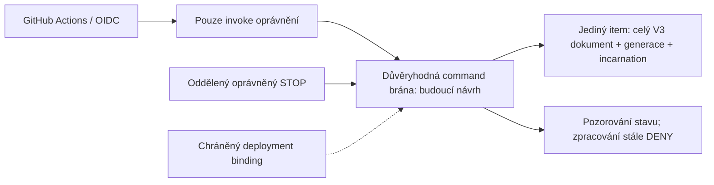

# Transakční V3 control store: rozhodnutí a hranice důvěry

Základ: `72e2d7999e7f8d263012ea13ab8c4272340bca6c`.

Nový čistý detached worktree: `/workspace/vrchcab-transactional-72e2d79`.
Předchozí pracovní kopie, jejich změny, indexy a HEAD zůstávají zachované.
Datum posouzení: 2026-11-09. Neproběhl živý AWS, Google, Cloudflare ani GitHub
API požadavek, vytvoření cloudového prostředku nebo produkční změna.

## Verdikty a doporučení

Verdikt se vztahuje k celé architektuře připravené k produkčnímu použití,
včetně oprávnění, obnovy, identity a provozních podmínek, nikoliv jen existence
databázového API. Čistě offline posouzení zde žádného kandidáta neschvaluje.

| Kandidát | Verdikt | Důvod a role v dalším návrhu |
| --- | --- | --- |
| AWS DynamoDB | **neprokázáno** | Vhodné datové primitivum pro další ověřování; přímý worker write grant je nevhodný. Doporučený první kandidát jen za serverovou command bránou |
| Google Firestore | **neprokázáno** | Precondition/update time a transakce jsou použitelné; je nutné vyřešit IAM versus Security Rules, retry a obnovu. Aktuální ceny nedoloženy |
| Cloudflare Durable Objects, SQLite | **neprokázáno** | Silný konkurent jednoduchostí singleton actoru a doloženou Free kvótou; nejsou ověřeny konkrétní OIDC brána, deployment, PITR a runtime |
| GitHub GraphQL `updateRefs.beforeOid` | **neprokázáno** | Explicitní ref podmínka je silnější než Contents SHA, ale nativně nevynucuje pravidla vlastníka a generace všech writerů; další Git/permission složitost |

**Doporučení:** ponechat DynamoDB jako první kandidát pro architekturu
`invoke-only worker → důvěryhodná command služba → jediný control item`.
Neuzavírat volbu poskytovatele před doplněním aktuálních cen AWS/Firestore
a kontrolou skutečných policy. Durable Objects Free je cenově vážná alternativa,
ne automaticky horší volba. Žádná služba nebyla zvolena nebo aktivována napevno.

Úzký návrhový audit dovoluje **jen vyhodnocovací offline prototyp interního
datového protokolu DynamoDB**. Nejde o hotovou command bránu nebo schválení
celé produkční architektury. Překážka níže byla zdokumentována před jeho
implementací; není zamaskována další službou nebo klientským `verified=True`.

## Zásadní překážka přímého DynamoDB přístupu

Přímé přidělení `dynamodb:UpdateItem` workerům nelze považovat za bezpečný
claim protokol. Omezení klíče a atributů není vynucením `ConditionExpression`
nebo `UpdateExpression`. Writer schopný obejít Python adapter může tentýž
item aktualizovat bez očekávané generace, snížit generaci nebo přepsat vlastníka.
Klientské tvrzení, že vždy používá CAS, tuto hranici nezajišťuje.

Tato varianta návrhovým auditem neprochází. Není automaticky nahrazena jinou
službou a nevzniká živý adapter ani oprávnění k používání DynamoDB.

Další posuzovaná varianta musí obsahovat důvěryhodnou serverovou command
bránu, která je jedinou zapisující aplikační autoritou. GitHub workery nemají
raw DynamoDB write oprávnění. Brána přijímá pouze úzké přechody, nikoliv
libovolný nový control dokument nebo libovolný UpdateExpression. Její kód,
deployment role a privátní databázová role jsou součástí důvěryhodné základny;
IAM nechrání před kompromitovanou touto rolí nebo privilegovaným správcem.

Model výslovně demonstruje broad-grant writer, který vynechá podmínku,
vrátí původní dokument i generaci a následně dovolí druhé potvrzení vlastníka.
To dokazuje riziko tohoto grantu, ne výsledek skutečné AWS IAM simulace nebo
neexistenci jakékoliv budoucí policy. Současný úplný seznam service condition
keys nebyl kvůli nedostupnosti webové dokumentace nezávisle ověřen. Nelze
prohlásit, že konkrétní nepředložená IAM politika vynucuje potřebné výrazy.

Před nasazením musí být doloženo omezení všech zápisových cest: raw
Put/Update/Delete/Batch/PartiQL, transakčních API, přepnutí authority, změny
policy, pass-role, kódu a konfigurace brány i restore. Transakční API se
mohou autorizovat přes podkladové akce; není bezpečné předpokládat jeden
samostatný IAM action název podle názvu API. Žádná deployovatelná IAM politika
se zde negeneruje. Vynucení musí být přezkoumáno proti aktuální autorizaci
služby a konkrétním rolím. Přidání brány samo o sobě IAM důkaz nenahrazuje.

## Jediná autorita a navržený dokument



Jeden přesně určený region/account/table/partition key, žádné per-worker
tabulky ani oddělený ledger vlastníků. Návrh základního itemu:

```text
pk                pevný controller key ze serverové konfigurace
incarnation       pevná identita nasazení této autority
generation        celočíselná, monotónní, bez recyklace
document          DynamoDB Map s celým OfflineControlStateV3:
  version=3, enabled, approval_epoch,
  last_intent_at, last_slot, pending,
  daily_quota {day_utc, attempts, reserved_usd},
  worker_claim {intent_id, approval_epoch, request_id, claimed_at, owner}
```

`document` obsahuje každé obchodní pole právě jednou. Guard pole nejsou
duplikována v odděleném JSON blobu a samostatné tabulce. Finanční hodnoty
zůstávají přesné desetinné stringy stávajícího validátoru, nikoliv float.
Metadata authority/generace a dokument tvoří jediný atomicky měněný item.
Existující V2/V3 codec se nemění; envelope je pouze izolovaný návrh storage
formátu. Není migrační cestou. Všechny existující tracked soubory se zachovávají.

Broker musí vlastnit PK a binding. Externí command není libovolný nový item,
tabulka, policy, výraz nebo owner objekt. Claim command by obsahoval korelaci
intentu/epochy/request ID a autentizovaný token; vlastníka by odvodil server.
STOP musí autorizovat nezávislý oprávněný principal. Brána nesmí publikovat
obecné `compare_and_swap(new_state)` rozhraní workerům. Prototyp je interní
storage engine, takovou autentizovanou síťovou bránu neimplementuje.

Budoucí vazba schváleného run ID na intent musí být součástí stejného
autoritativního návrhu. Současný rezervovaný intent tento úplný runtime
binding neposkytuje. Rozšíření jeho schématu vyžaduje další samostatnou revizi;
není zde potichu doplněno nebo nahrazeno callerem dodaným SHA.

## DynamoDB datový protokol

Oficiální aktuální service model v botocore dokumentuje:

- `GetItem` má default eventual consistency; `ConsistentRead=true` žádá
  poslední aktualizovanou hodnotu. Použije se base table, ne GSI/DAX/cache.
  Chybějící item znamená nedostupnou autoritu, nikoliv povolení inicializovat.
- `UpdateItem.ConditionExpression` určuje podmínku nutnou pro úspěch.
  Je volitelná, není povinnou součástí každého API requestu.
- `UpdateExpression SET generation = generation + :one` podporuje číselný
  inkrement v téže operaci. Hodnota `:one` musí být serverová konstanta +1.
- `ReturnValues=ALL_NEW` vrací všechny atributy po změně, hodnoty jsou
  dokumentovány jako strongly consistent a bez dalších read capacity units.
  Tvar HTTP 200 sám tuto sémantiku ani důvěryhodnost prostředí neprokazuje.

Prototyp přečte celý item silně konzistentně a porovná jeho opaque revision
s očekáváním. Revize zahrnuje deployment authority, tabulku/key, incarnation
a generaci. Nelze ji odvodit jen z obsahu dokumentu. Pak přijme pouze:

1. `claim`: aktivní stejný control stav, přesně tentýž pending intent a epochu,
   prázdný claim → jeden nový záznam; veškerá kvóta a rezervace beze změny;
2. `stop`: enabled True → False při zachování úplného zbytku stavu a vlastníka.

Podmínka jednoho UpdateItem ověřuje existenci klíče, incarnation, generaci,
její mez, V3 verzi, aktivaci, epochu a rovnost **celého** původního dokumentu.
Claim navíc kontroluje intent a NULL typ původního claimu. Map equality
chrání i změnu jiného writeru, který by změnil pole bez řádného zvýšení generace.
Update mění pouze claim nebo enabled a současně zvyšuje generaci. Žádné
upsert, vytvoření itemu, změna kvóty, znovuzapnutí nebo reset se neposkytují.

Po odpovědi se vyžaduje kompletní ALL_NEW item přesně odpovídající návrhu
a opětovný strong readback. Metadata musí odpovídat 200 bez hlášených retry.
Tato kontrola metadat není důkazem bezpečné konfigurace libovolného transportu.
Timeout, reset, neúplný ack, konflikt, změněný readback či retry znamenají
`requires_reconciliation=True`, žádné další psaní. Zápis už mohl proběhnout.
Ani ConditionalCheckFailedException nedokazuje, že předchozí skrytý SDK
pokus nic neuložil. Není automatické přečtení a opětování nejasného zápisu.

Opakování a restart nevracejí další kladné potvrzení; uložený vlastník
nevyprší a neodstraní se. Žádná lease, takeover, heartbeat, TTL ani automatická
denní obnova kvóty. Žádný fallback na jinou službu. Všechna pozorování mají
`execution_allowed=False` a nejsou důkazem autentizované identity.

Prototyp konzervativně omezuje wire item na 4096 bajtů a generaci na
`2**63-1`; nejde o obecný limit DynamoDB. Poslední inkrement je vyhrazen OFF:
claim se odmítne dříve, než by tento prostor spotřeboval. Vyčerpaná aktivní
autorita je neplatná. Síťový výpadek nebo quota exhaustion však může zabránit
i trvalému OFF zápisu; v takovém stavu se úspěch zastavení netvrdí a každý
budoucí placený krok musí při neověřitelném stavu sám zastavit.

## Kdo dokáže porušit invarianty a co musí být vynuceno

| Hrozba | Požadovaná hranice | Co zde zůstává neprokázané |
| --- | --- | --- |
| Worker vynechá condition nebo napíše nižší generaci | Worker bez raw DB write, pevné serverové commands | Skutečné IAM/resource policy/SCP a absence dalších credential cest |
| Přepsání vlastníka jiným writerem | Stejná command autorita a monotónní pravidla pro **všechny** writery včetně controlleru | Deployment brány, autorizace commands a její TCB |
| Kompromitace broker role nebo změna jejího kódu | Oddělená chráněná deployment role, zákaz assume/pass-role/update-code pro workery, audit a break-glass postup | IAM samo nevynucuje invarianty proti vlastní privilegované serverové roli |
| Restore/rollback celého itemu | Chráněný binding mimo obnovovaný snapshot, nový incarnation/authority po nezávislé rekonciliaci | Skutečný restore postup a jeho privilegia |
| Smazání a opětovné vytvoření stejné tabulky | Zákaz delete/recreate v aplikačních rolích; ověření identity tabulky a podmínek cutoveru | ARN obsahující stejné jméno může být znovu použit; ARN samo není unikátní generace |
| Více regionů | V tomto návrhu jediný region a jedna autorita | Globální tabulky a jejich režimy se zde neověřují ani nepovolují |
| Nejistý výsledek + restart | Durable owner/generation, explicitní STOP a nezávislá rekonciliace | Správnost cizího retry/recovery orchestrátoru |

Model používá původní jednořádkový SQLite test backend pro uložení celé
syntetické DynamoDB položky. Vyhodnocuje emitovanou podmínku a SET subset,
ne jen flag úspěchu. Ověřuje logiku a deterministické interleavingy; není
DynamoDB Local, IAM simulátor nebo důkaz skutečné služby.

Samotný klientský engine veřejně držící transport není autorizační hranicí.
Test raw-writer záměrně ukazuje, že se serverová podmínka dá obejít, pokud má
jiný proces raw UpdateItem grant. Test s principalem `worker` ukazuje pouze
**navrhované** odepření této cesty v modelu, nikoliv ověřenou AWS policy.

## Obnova a nerecyklovaná autorita

Aktuální DynamoDB service model říká, že backup/PITR restore vytváří **novou
tabulku**, a vyžaduje znovu nastavit IAM, tagy a další konfiguraci. To není
automatická bezpečná migrace. Nový zdroj se nesmí sám stát autoritou kvůli
shodě názvu nebo tomu, že obsahuje starý validní V3 JSON.

Binding je chráněná konfigurace deploymentu, ne druhý claim ledger. Před
cutoverem musí být OFF, zrušeny staré invokace a nezávisle vysvětleni původní
vlastníci. Následuje nový incarnation a přesně schválený fyzický cíl. Je nutné
zohlednit TableId i možnost znovupoužití názvu/ARN; samotný starý ARN nebo
incarnation přečtený ze stejného backupu nestačí. Tag/fence pravidla lze použít
jen po ověření konkrétní podpory a nezměnitelnosti všemi aplikačními rolemi.

Pokud privilegovaný writer obnoví původní dokument **i generaci a incarnation**
pod stejným bindingem, vznikne znovu ABA. To je výslovný protipříklad v testech,
nikoliv vyřešená vlastnost prototypu. Žádný lokální Python check neochrání
proti správci, který ovládá data i jejich trust konfiguraci. Takový přístup je
součástí chráněné control plane a nesmí být přidělen workerům. Bez důkazu
těchto oprávnění nelze použít verdikt „vhodný“ pro produkci.

## SDK retry: zdroj i skutečná offline laboratoř

V odděleném venv byl z veřejné distribuce instalován botocore **1.43.126**,
shodný s verzí z prozkoumané připnuté source revize. Všech pět wheelů je
uloženo se SHA-256 a frozen requirements; instalace do venv proběhla přes
`--no-index --require-hashes`. Projektové pyproject/poetry.lock se nemění.
Botocore není novou závislostí hlavního bota.

`tools/verify_dynamodb_sdk_offline.py` nepoužívá Stubber, který by obcházel
HTTP retry vrstvu. Používá skutečný klient/Endpoint, falešnou HTTP response
nebo connection pool, explicitní syntetické credentials, `.invalid` endpoint,
zakázanou síť a /dev/null profily. Všechny síťové pokusy v test procesu se
kontrolují i tehdy, když je knihovna zachytí.

| Ověřená situace v této konkrétní verzi | Skutečný počet simulovaných HTTP pokusů |
| --- | --- |
| Výchozí DynamoDB legacy, opakované 500 | **10** |
| Standard režim bez explicitního limitu, 500 | **3** |
| `Config(retries={mode: standard, total_max_attempts: 1})`, Get/Update | **1**, i s prostředím AWS_MAX_ATTEMPTS=9/AWS_RETRY_MODE=adaptive |
| Model commit + ztracený ACK, standard default | **2**; druhý vrátí ConditionalCheckFailed, přesto model uložil první |
| Totéž s total_max_attempts=1 | **1**, nejasný výsledek bez opakování |
| Skutečná HTTP-session s falešným pool | **1**, urllib3 `Retry.total=False` |
| Celý prototyp přes skutečný SDK a syntetickou HTTP službu | **GetItem → UpdateItem → GetItem**, potvrzení pouze syntetického stavu |

`total_max_attempts=1` zahrnuje počáteční request. `max_attempts` uvnitř
Config naopak počítá retries; podobně pojmenovaná proměnná prostředí má jiné
počítání. Nestačí spoléhat na default nebo jednu obalovou Python funkci.
Všechny vrstvy budoucího invokeru/brokeru musí mít ověřené nastavení; Lambda
async, queue/redrive či klientská smyčka se zde nepřidávají. Retry credential
exchange není totéž jako retry control zápisu; oficiální AWS action má
assume-role retry default 12 a vstup `disable-retry`.

Při prvním laboratorním běhu guard zachytil importní urllib3 IPv6 probe
`bind(::1)`, celkový výsledek proto správně selhal. První log je zachován.
Finální testový proces před importem potlačuje tento lokální capability probe
pomocí `socket.has_ipv6=False`; žádný guard nebo záznam události se nemaže
či neobchází. Netestuje se IPv6 ani skutečné TLS spojení. Finální SDK běh
má **6/6 prošlých metod a 0 síťových pokusů**. Není to test AWS služby.

## OIDC bez dlouhodobých cloudových klíčů

Pro budoucí AWS variantu je kandidátem GitHub OIDC → STS krátkodobá invoke
role. Role jobu nesmí mít raw DynamoDB write, assume/pass-role na broker,
změnu deploymentu/policy nebo obnovu tabulky. Broker execution role je oddělená
a omezená na konkrétní control item. V tomto úkolu žádná role/provider/token
nevznikají a skutečný OIDC token se nevyžadoval ani nezískával.

Aktuální oficiální README AWS action již popisuje rozšířené podporované OIDC
claims a immutable `sub` s číselnými ID pro nové/opt-in/přejmenované repozitáře
od července 2026. Nepřebíráme staré tvrzení, že AWS umí vždy jen sub/aud,
ani neodhadujeme skutečný sub tohoto repozitáře z jeho názvu. Přesná sada
condition keys, audience, subject a jejich vazba na repository/owner ID,
workflow, commit/run/attempt musí být nezávisle ověřena před trust policy.
Nelze použít absent/misspelled claim jako úspěšnou podmínku.

STS credentials nebo platný GitHub JWT dokazují workflow/role kontext,
nikoliv to, že se skutečně vykonává schválený bot, checkout, závislosti,
konfigurace a prompty. Session name, lokální GITHUB_SHA nebo claim objekt
nejsou náhradou tohoto důkazu. Existující `CONTROLLER_VERIFIER=None`
zůstává zachovaný, stejně jako trvalý execution DENY. Budoucí broker musí
kontrolovat autentizované požadavky a nesmí od klienta přijímat `verified=True`
nebo hotový owner. Artifact/configuration binding je další nevyřešený návrh.

Google varianta nabízí GitHub WIF a krátkodobé credentials podle oficiálního
`google-github-actions/auth`. Je nutné ověřit mapování/conditions a to, zda se
daná cesta autorizuje IAM nebo Firebase Security Rules. U Python serverového
IAM SDK se nesmí předpokládat vynucení klientských Firebase Rules; přímý
admin/write principal může serverová pravidla obejít. Konkrétní Rules/IAM
konfigurace a Firebase-token bridge zde nebyly ověřeny nebo vytvořeny.

U Durable Objects musí být ověřený ingress Worker jedinou vstupní cestou do
pevného singleton actoru; úložiště je dokumentováno jako přístupné jen zevnitř
DO. JWT/trust/deployment/namespace/PITR authority vyžadují samostatný návrh.
Nevytvářet actor pro každý worker nebo run, což by rozdělilo autoritativní stav.

## Nezávislé porovnání služeb

### DynamoDB

Výhoda je jednoduchý jeden item, přímý Python low-level SDK, strong GetItem,
podmínka a inkrement v jediném UpdateItem, krátkodobé AWS credentials a jasný
samostatný serverový deployment. Cena této jednoduchosti je **povinná brána**,
její TCB a správná oprávnění všech writerů. Není prokázána provozní atomicita,
durability, IAM nebo restore konkrétního prostředí. Žádné global tables,
multi-region writer, GSI, DAX nebo TTL v navržené první variantě.

### Firestore Standard / Native

Aktuální oficiální Python typy uvádějí monotónní `update_time` při každé
změně dokumentu a precondition posledního update time. Transakční wrapper
má default **MAX_ATTEMPTS=5** a opakuje callback při konfliktech; další RPC
retry je samostatná vrstva. Budoucí implementace musí prověřit `max_attempts=1`
a `retry=None` pro použité RPC, žádné externí účinky uvnitř retry callbacku.
Runtime Google SDK zde nebyl instalován ani spuštěn; jde o čtení oficiálního
zdroje, nikoliv jeho dynamický test.

Native Rules mohou být silnější datovou hranicí než klientský CAS, pokud
se na konkrétní autentizační cestu skutečně vztahují. Musely by vynucovat
field delta, +1 generaci, nezměnitelnost vlastníka a STOP. Nelze jejich účinek
připsat každé IAM/service-account cestě. IAM admin, restore/import, nové
database/project identity a další writeři potřebují vlastní ochranu.
Python integrace je přirozená, ale identity/Rules rozdíl a nedoložené ceny
nedovolují tuto alternativu označit za hotové jednodušší řešení.

### Cloudflare Durable Objects, SQLite

Jeden actor s transakcí nad celým řádkem přirozeně umísťuje pravidla na server
a nemá veřejné raw storage API. Dokumentace podporuje `transactionSync`;
SQL cursor držený přes `await` není stabilní snapshot. Callback nesmí vykonávat
forecasting ani síťové vedlejší účinky. Pozor na JS numerickou přesnost při
velké generaci: nepřevádět opaque revize na Number, zvolit přesný formát a meze.
Python bot může volat úzké HTTPS commands; serverová implementace, runtime
podpora zvoleného jazyka, OIDC a deployment ještě vyžadují ověření.

Aktuální dokumentace runtime říká default až **5 pokusů**, stejné request ID
při nejasném doručení a potlačení druhého vykonání, pokud metoda nebyla označena
`retryable()`. To není permanentní vlastnictví nebo deduplikace restartovaného
klienta. Pro náš režim zvolit `retry: {maxRetries: 0}`, neoznačovat claim jako
opakovatelný. Tyto vlastnosti byly čteny, nikoliv spuštěny v Cloudflare runtime.

PITR umožňuje návrat SQLite databáze do posledních 30 dnů. Restore bookmark,
`deleteAll`, změna namespace/name nebo serverového kódu mohou obnovit starého
vlastníka/generaci. Musí být uzavřené v control plane se stejným fence a
rekonciliací jako u ostatních kandidátů. Bez tohoto důkazu zůstává neprokázáno.

### GitHub GraphQL updateRefs / beforeOid

Oficiální schema uvádí atomické all-or-nothing změny referencí a volitelný
`beforeOid`. Explicitní expected head a čerstvý child commit oddělí A→B→A
obsah od historie commitů. Opuštění beforeOid, no-op, force rewind nebo
delete/recreate reference vlastnost poškodí. Samotná permission contents:write
nevynucuje, že všechny cesty zachovají owner a generaci.

Nativní dokumentová pravidla by vyžadovala další důvěryhodnou kontrolu všech
writerů, jejich bypassů a obnovy. Přibývá tvorba a kontrola Git objektů,
stromu/rodiče a potvrzení GraphQL `errors` i při HTTP 200. API atomicita
referencí není transakce s billingem či skutečným vykonáním workeru. Proto
nejde o automaticky jednodušší alternativu k serverové command službě.

## Ceny a bezplatné kvóty: co je a není aktuálně doloženo

Ceny jsou veřejné informace, ne ověření osobního účtu. Měna USD, bez daní,
regionálních rozdílů, slev a FX. Přímé webové stránky AWS a Firebase i další
provider dokumentace vracely v prostředí 403. Nebyla použita cloudová pricing
API ani účetní/billing API. Nezískané aktuální ceny se nenahrazují pamětí
nebo starým ceníkem a **nejde o potvrzení, že AWS/Firestore budou zdarma**.

| Kandidát / režim | Doložené veřejné informace | Zásadní mezera |
| --- | --- | --- |
| DynamoDB Standard on-demand/provisioned | Get/Update shape a read/write jednotky protokolu; cena může záviset na velikosti/regionu/módu | Aktuální USD sazby, Free Tier/kredity a způsobilost se nepodařilo ověřit; rozpočet nesmí počítat s free nárokem |
| Firestore Standard | API `Database.free_tier` potvrzuje nejvýše **1 eligible databázi na projekt**, další použití nad free limit je placené | Aktuální číselné denní kvóty, regionální sazby a entitlement nejsou doložené |
| Durable Objects SQLite / Workers Free | **100 000 DO requestů/den; 13 000 GB-s/den; 5 mil. čtených řádků/den; 100 000 zapsaných řádků/den; 5 GB celkem** | Vlastní plán/ostatní workload a skutečné runtime CPU/auth nároky neověřeny |
| Workers Paid + DO SQLite | Minimum **$5/měsíc**; DO **1 mil. requestů + $0.15/mil.**, **400 000 GB-s + $12.50/mil. GB-s**; SQL **25 mld. reads + $0.001/mil.**, **50 mil. writes + $1/mil.**, **5 GB-month + $0.20/GB-month** | Limity jsou sdílené s ostatním usage; veřejný ceník neověřuje konkrétní účet |
| GitHub updateRefs | Dokumentované limity GraphQL: typicky **5 000 bodů/h uživatel**, **1 000 bodů/h/repo GITHUB_TOKEN**, jiné plány/instalace se liší | Nejde o finanční free kvótu; runner compute a storage se účtují dle plánu; konkrétní účet nebyl kontrolován |

Zdroj Cloudflare dále říká, že Free limit po vyčerpání vede k chybě operace,
denní limity resetují v 00:00 UTC, Free podporuje SQLite DO, ne legacy KV.
Výpočet DO nezahrnuje volající Worker. Paid Workers má další request/CPU
allowance a DO duration se účtuje z wall-clock s 128 MB alokací, ne skutečné
velikosti řádku. Billable přebytek se zaokrouhluje na účtovací jednotky.
Nesměšovat ceník SQLite a legacy KV.

Konkrétní cenová rizika:

- Paid plán za $5 měsíčně může dominovat nad cenou několika tisíc control
  operací. Pro Free nelze slíbit dostupnost OFF po vyčerpání kvóty. CPU limit
  Free Workeru a náklady JWT ověřování vyžadují měření v konkrétním runtime.
- Nehibernující DO, WebSocket, čekající I/O, alarms a více actorů mohou
  zásadně změnit duration/requests. Control služba nemá provádět výzkum.
- AWS broker, invocation gateway, log retention, KMS/backup/PITR, NAT,
  transfer nebo nadbytečné indexy mohou být dražší než jediný item. Není
  schváleno vytvářet tyto prostředky kvůli domnělé úspoře několika centů.
- Conditional failure ani retry se nesmějí považovat za bezplatné. Capacity
  metering chyb a aktuální sazby musí být ověřeny před finančním odhadem.
  Default SDK s až deseti pokusy amplifikuje provoz i nejasnost výsledku.
- AWS/GCP budget alert není automaticky tvrdý spend cap. Limity služby mohou
  místo zvýšení nákladů znepřístupnit control store; nesmí to otevřít worker.
- Firestore opakované transakce, dodatečná čtení pro pravidla/indexy, zálohy
  a restore mohou změnit účet. Nepřebíráme historické denní kvóty jako platné.

Pro plánování lze oddělit počty od nedoložených cen. Hypotetických 10 000
strong reads a 10 000 úspěšných writes do 4 KiB položek znamená v on-demand
modelu nejvýše 10 000 read a 40 000 write jednotek. Při sazbách `pR` a `pW`
USD za milion je datová složka `0.01*pR + 0.04*pW`; to není aktuální ceník,
finanční strop ani celková cena brány. Bez sazeb nevydáváme USD garanci.
Při dnešním nevyřešeném rozporu 4 Agent POST proti limitu 2 se žádný skutečný
forecast nepovolí, i kdyby control store byl bezplatný a správný.

## Důkazy, které ještě chybí, a postup budoucího nasazení

1. Nezávisle přezkoumat návrh, zvolený region/edici, aktuální ceníky a
   bezplatné nároky. Rozhodnutí služby je další schvalovaný krok.
2. Doložit všechny aplikační a administrativní writery, skutečné IAM/Rules,
   nemožnost worker bypassu a oddělení deployment/break-glass oprávnění.
   Připravit pevné serverové commands a jejich autorizaci; neexponovat engine.
3. Definovat chráněný physical authority binding a restore/cutover postup
   s OFF, nezávislou rekonciliací vlastníků a novým incarnation. Nedovolit
   znovupoužití starého identifikátoru nebo automatický fallback.
4. Připnout SDK i serverový artifact/configuration a ověřit všechny retry
   vrstvy, invoker i error/timeout potvrzení. Nezískávat klíče přes chat.
5. Vyřešit produkční OIDC klíče/policy a nezávislý runtime artifact binding.
   Workflow identity není tento důkaz. Nynější NONE/DENY brány zachovat.
6. Teprve po další explicitní autorizaci navrhnout případnou kontrolovanou
   cloudovou validaci, role testy a restore/collision testy mimo produkci.
   V tomto úkolu žádná taková operace není provedena ani naplánována jobem.
7. V2 → V3 migrace, seed OFF a případná aktivace jsou oddělené budoucí úkoly.
   Neztratit pending owner ani rezervaci, nezavést druhý ledger. Dnešní engine
   nemá init, reserve, settle, release, re-enable nebo migrační API.
8. Před jakýmkoliv skutečným výzkumem musí být navíc vyřešeny všechny
   původní limity a publikační podmínky; tento patch je nemění.

## Skutečné testy a omezení

| Běh | Výsledek |
| --- | --- |
| Nový stdlib DynamoDB model | **26/26 prošlo** |
| Původní runtime + Contents audit + tools | **37 + 27 + 19 prošlo** |
| Společný stdlib běh | **109/109, 0 failures/errors/skips a síťových pokusů** |
| Oddělená skutečná botocore laboratoř | **6/6, 0 failures/errors/skips a síťových pokusů** |
| Celkem aktuálních unikátních testů | **115 = 109 + 6** |
| Celý application SDK runner | **Nespouštěn; chybí správné projektové zamčené závislosti** |

Model zahrnuje dva soupeřící kandidáty, fresh-process restart, ABA i raw
writer bypass, změnu intentu, OFF před/po commitu, full-document guard,
timeout/reset/ztracený ACK, přerušení, stale read, neúplnou odpověď, restore
fence, smazaný item bez upsertu, headroom pro OFF, neměnnost owner/kvóty,
žádné lease a trvalé execution DENY. Neprokazuje skutečný AWS backend nebo IAM.

Python 3.12.14. Chybí requests/forecasting-tools/openai; PyJWT/cryptography
v hlavním prostředí nejsou v zamčených verzích. Nová modelová sada je stdlib;
samostatný SDK venv není potvrzením kompatibility forecasting SDK. Uživatelův
výsledek 608/608 z PR #37 je historický výsledek základu, ne nový místní běh.
Gramatika Pythonu 3.11 je pouze statická kontrola, nikoliv jeho interpreter.

```bash
python -B tests/test_dynamodb_cas_offline.py
# Jen v odděleném venv s přiloženým hash-pinned SDK labem:
/cesta/sdk-venv/bin/python -B tools/verify_dynamodb_sdk_offline.py --report /tmp/sdk-results.json
```

Nové stdlib testy zahrne standardní unittest discovery. Optional SDK tool má
jméno `verify_`, takže se bez SDK neimportuje do standardního runneru ani do
`tools/test_*.py`. Pro CI navrhuji přidat pět nových cest tohoto patchu do
offline path filtru a samostatně schválit SDK lab krok bez cloudových credentials.
**Žádný workflow ani jeho oprávnění se zde nemění.**

## Oficiální reference a reprodukovatelnost

Přesné URL, revize, úspěšná i neúspěšná čtení a SHA-256 jsou v externím
`reference-manifest.json`. Důležité připnuté zdroje:

- [DynamoDB service model](https://github.com/boto/botocore/blob/135910e22c937b9ff03b0948a633a2913d62af87/botocore/data/dynamodb/2012-08-10/service-2.json)
  a [Config](https://github.com/boto/botocore/blob/135910e22c937b9ff03b0948a633a2913d62af87/botocore/config.py).
- [Boto3 retries](https://github.com/boto/boto3/blob/ed37b7307d34ec755afb45f9db9a7b5eb6c1bb4d/docs/source/guide/retries.rst).
- [AWS Actions OIDC](https://github.com/aws-actions/configure-aws-credentials/blob/f95a14875b75259d2a3105bff6460ac2e653eea1/README.md).
- [Google auth](https://github.com/google-github-actions/auth/blob/12060449e87204eca501a11f2f7f1483024afff0/README.md)
  a [Firestore transaction](https://github.com/googleapis/google-cloud-python/blob/5af3258829b01c3e35f326350e5a566c76652f19/packages/google-cloud-firestore/google/cloud/firestore_v1/transaction.py).
- [Cloudflare pricing](https://github.com/cloudflare/cloudflare-docs/blob/e250a86a70fc9ef79eb9290e0d3b2b467aadfa39/src/content/partials/durable-objects/durable-objects-pricing.mdx),
  [runtime retries](https://github.com/cloudflare/cloudflare-docs/blob/e250a86a70fc9ef79eb9290e0d3b2b467aadfa39/src/content/docs/durable-objects/best-practices/automatic-retries.mdx)
  a [SQLite/PITR](https://github.com/cloudflare/cloudflare-docs/blob/e250a86a70fc9ef79eb9290e0d3b2b467aadfa39/src/content/docs/durable-objects/api/sqlite-storage-api.mdx).
- [GraphQL schema](https://github.com/github/docs/blob/8cd1075179df75319912891d6620c9cb78eefb4d/src/graphql/data/fpt/schema.docs.graphql)
  a [rate limits](https://github.com/github/docs/blob/8cd1075179df75319912891d6620c9cb78eefb4d/content/graphql/overview/rate-limits-and-query-limits-for-the-graphql-api.md).

Canonické AWS/Firebase pricing weby byly nedostupné; archivovaný
awsdocs developer-guide nyní obsahuje pouze oznámení o ukončení publikace,
proto jej nepoužíváme jako aktuální cenový ani autorizační důkaz. Firestore
standalone repo bylo přesunuto do oficiálního google-cloud-python monorepa;
zdroje byly následovány tam. Nedostupnost je explicitní mez důkazu.

Patch, jeho SHA-256, ZIP, manifest, zdrojové reference, modelové/SDK protokoly
a hash-pinned laboratorní wheely jsou určeny k nezávislé revizi. Ověřuje se
aplikace na přesný základ, reverze, Git strom a souborové hashe, včetně nového
testování aplikované kopie. Neproběhl cloud API call, provisioning, GitHub
zápis, změna workflowů, PR, merge, dispatch, migrace, placený výzkum,
skutečný forecast nebo publikování. V2/V3 NONE a execution DENY i plán
**2 reporty × 3 prognózy / 4 potřebné Agent POST / automatický limit 2**
zůstávají beze změny.
